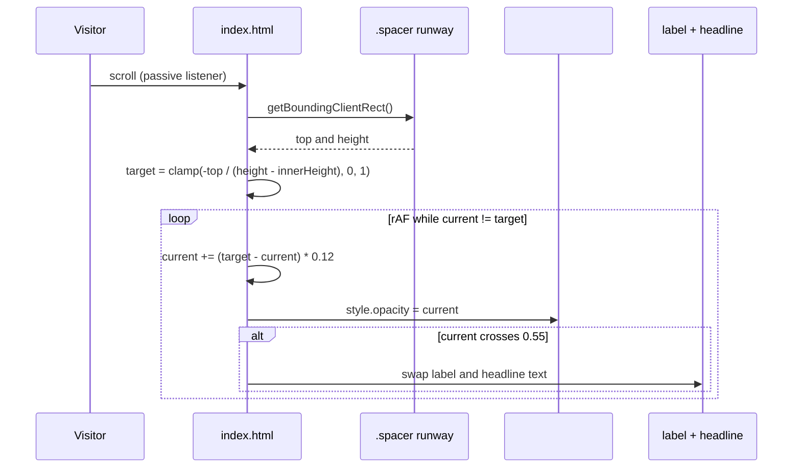

# Scroll-driven polarization demo

The single most important piece of JavaScript in this repository is the scroll controller at the bottom of `/index.html` (lines 247–283). It turns the static rainbow-test section into a tactile product demonstration: as the visitor scrolls, the stressed-lens photograph dissolves into the stress-free one, and the copy flips at the midpoint to match.

There are no dependencies, no build step, and no framework — plain DOM APIs and `requestAnimationFrame`.

## Mechanism overview

The trick is a **scroll runway plus a sticky stage**. A 180vh `.spacer` sits inside a `position: sticky; height: 100vh` container, so the stage stays pinned on screen while the visitor scrolls through the runway. The scroll position within the runway maps to a normalized progress value, which drives the cross-fade.



## Progress calculation

`measure()` computes the scroll progress:

```js
const r = spacer.getBoundingClientRect();
const total = r.height - window.innerHeight;
target = Math.min(1, Math.max(0, -r.top / total));
```

- `r.top` is the runway's distance from the top of the viewport. It is `0` when the runway starts entering and negative once scrolled past.
- `total` is the scrollable distance the runway contributes, i.e. its height minus one viewport height.
- The ratio is clamped to `[0, 1]`, so progress is 0 before the section and 1 after it.

`measure()` is bound to both `scroll` and `resize` with `{ passive: true }`, so it never blocks scrolling and also re-normalizes when the viewport height changes (important, because `total` depends on `window.innerHeight`).

## Inertial smoothing

The visible value is not `target` directly. `tick()` runs an exponential approach:

```js
current += (target - current) * 0.12;
if (Math.abs(target - current) < 0.0015) current = target;
```

- The `0.12` factor is a frame-rate-independent-ish lerp that gives the fade a slight, deliberate inertia rather than a hard linear mapping.
- The `0.0015` epsilon snaps `current` to `target` when the difference becomes negligible, so the animation actually terminates.
- `rafId` is only re-requested while `current !== target`, so the rAF loop idles when the page is at rest — no permanent frame loop burning CPU.

`pureImg.style.opacity = current` is the only visual output of the smoothing, applied every frame. The starting value comes from CSS: `.stage .pure { opacity: 0 }`.

## Midpoint copy swap

A binary state is derived from the smoothed value:

```js
const state = current > 0.55 ? 1 : 0;
if (state !== lastState) { lastState = state; /* rewrite label + headline */ }
```

The `lastState` guard ensures the copy is rewritten only on an actual transition, not on every frame. Two full copy sets alternate:

| State | Label (`#stageLabel`) | Headline (`#testHeadline`) |
|---|---|---|
| Stressed (`current ≤ 0.55`) | 普通 PC 镜片 · 正交偏振片下 | 每一片注塑镜片都藏着应力。<br>你只是还没看见它。 |
| Stress-free (`current > 0.55`) | CLARIS 无应力镜片 · 正交偏振片下 | 我们的镜片，让应力归零。<br>同样的偏振片，什么都不剩。 |

Both are written with `innerHTML` because the headline contains a `<br>`.

Note the semantics of the label: "正交偏振片下" means *under crossed polarizers*. That is the physical method behind the whole demonstration — a lens with residual birefringence rotates polarized light, which transmits differently through the crossed analyzer and shows as rainbow fringes. A stress-free lens shows uniform extinction. The copy depends on the visitor understanding that the two photos were taken with the same polarizer setup.

## Hero video fallback

```js
const v = document.getElementById('heroVideo');
v.addEventListener('error', () => { v.style.display = 'none'; }, true);
```

The `error` listener is registered with capture (`true`) so it catches media errors that do not bubble to `video`. On failure the video is hidden and the static `assets/hero2_001.jpg` background — already layered underneath at the same position and size — becomes the visible hero image. The page therefore degrades to a still hero rather than showing a broken media element.

## Editing guidance and pitfalls

- **Keep the copy sets paired.** Changing one headline without the other leaves the section internally inconsistent; there are exactly two states and no intermediate copy.
- **Do not remove the `.spacer` height.** The progress math divides by `r.height - window.innerHeight`; collapsing the runway to zero height makes `total` zero and the scroll behavior undefined.
- **The sticky container must stay `height: 100vh`.** It defines the viewport over which progress is computed.
- **If you swap the comparison photos**, update both `img.stressed` and `img.pure` in the markup; the JS never touches the `src` attributes, only `#pureImg`'s opacity.
- **Respect `prefers-reduced-motion`.** The script does not check it. If motion sensitivity matters for this page, gate the rAF loop behind a media query and show the stress-free image statically — the fallback is straightforward because the end state is just `opacity: 1` on `#pureImg` with the stress-free copy set.
- **The `willChange` hint** on `pureImg` (`pureImg.style.willChange = 'opacity'`) is set once at startup to keep the opacity animation on the compositor. Keep it if you keep the cross-fade.

## Verified behavior at a glance

| Input | Expected result |
|---|---|
| Page load at top | Hero video plays muted and looping; rainbow-test label shows the stressed variant; `#pureImg` opacity 0 |
| Scroll into the rainbow test | Stressed photo fades out while the stress-free photo fades in over the 180vh runway |
| Crossing ~55% progress | Label and headline swap to the CLARIS variant, once |
| Scroll past the section | `#pureImg` opacity settles at 1; rAF loop stops |
| Video file missing or undecodable | Video hidden, static hero image shows, no error surfaced to the user |
| Viewport resized mid-scroll | `measure()` re-runs on `resize` and progress re-normalizes |
| Width ≤ 640 px | Nav padding and link spacing tighten; all other layout rules are fluid |