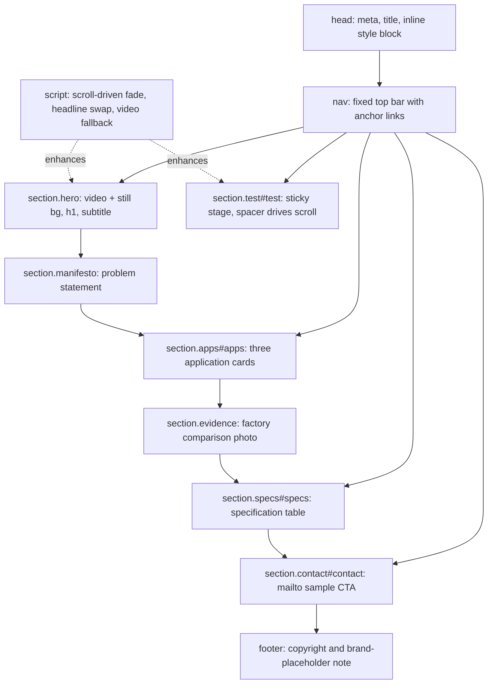

# Page architecture and design system

Everything in this page refers to `/index.html`, a single 285-line file with three parts: a `<style>` block in `<head>`, the body markup, and one inline `<script>`. There are no external stylesheets, no CSS framework, and no build step.

## Document skeleton



The nav links to `#test`, `#apps`, `#specs`, and `#contact` only. Manifesto and evidence are reachable by scrolling alone. `html { scroll-behavior: smooth }` makes the anchor jumps animate.

## Design tokens

All color and motion decisions flow from a small set of custom properties on `:root`:

| Token | Value | Used by |
|---|---|---|
| `--bg` | `#000` | `body` background |
| `--fg` | `#f5f5f7` | primary text |
| `--dim` | `#86868b` | secondary/muted text, nav links, captions |
| `--rainbow` | `linear-gradient(90deg, #ff5e3a → … → #ff5ec4)` | logo accent, card numbers, headline/CTA accents |

The rainbow gradient is applied via `background-clip: text; color: transparent`, so the accent color comes from the gradient rather than a solid fill. Two variants exist:

- `--rainbow` — static gradient (nav logo, card numbers, CTA heading).
- `.rb-anim` — a second, longer gradient with `background-size: 300% 100%` and a `flow` keyframe animation (`50% { background-position: 100% 0 }`, 9 s, ease-in-out, infinite). Used only on the hero headline's second line.

Fonts: `-apple-system, "PingFang SC", "SF Pro Display", "Helvetica Neue", "Microsoft YaHei", sans-serif` — a CJK-capable system stack, with no webfont download.

## Section-by-section structure

### Nav
`position: fixed`, `z-index: 100`, `backdrop-filter: blur(20px) saturate(180%)` over a translucent black background. Logo is `CLARIS` + a rainbow `·` + `OPTICS`. Link colors are `--dim` and transition to `--fg` on hover.

### Hero
`height: 100vh`, flex-centered, `overflow: hidden`. Two stacked background layers, both `position: absolute; inset: 0; object-fit: cover; opacity: .85; z-index: -1`:

1. `<video autoplay muted loop playsinline>` — `assets/hero-loop.mp4`
2. `` — `assets/hero2_001.jpg`

A `::after` pseudo-element overlays a radial gradient (`transparent 30%` → `#000 85%` from the 50%/70% point) so the headline stays legible against the moving footage. The `h1` uses `clamp(40px, 7vw, 92px)`; the subtitle uses `clamp(16px, 1.6vw, 21px)` with a `max-width: 640px`. A `.cue` element ("下滑 · 彩虹测试") bobs with a `bob` keyframe (`translateY(8px)` + opacity dip, 2.2 s).

### Rainbow test (`#test`)
The scroll engine of the page. Structure:

```
section.test#test
  div.spacer            /* height: 180vh — the scroll runway */
    div.sticky          /* position: sticky; top: 0; height: 100vh */
      h2#testHeadline
      div.stage         /* 16/9 aspect ratio, rounded, masked */
        img.stressed    /* assets/stress2_001.jpg */
        img.pure#pureImg /* assets/pure2_001.jpg, opacity: 0 initially */
        div.label#stageLabel
```

`.stage` is `width: min(880px, 90vw)` with `aspect-ratio: 16/9`, `border-radius: 24px`, a deep `box-shadow`, and a vertical `mask-image` that fades the top and bottom edges (`transparent 0%, #000 12%, #000 82%, transparent 100%`) so it dissolves into the black page. `.stage .pure { opacity: 0 }` is the starting state for the cross-fade.

`.spacer` provides 180vh of runway inside a `position: sticky` viewport-sized container — this is what makes the scroll-progress calculation in [interactions](interactions.md) well-defined.

### Manifesto
`max-width: 820px`, `padding: 20vh 24px`, `clamp(24px, 3vw, 40px)` at weight 600. Two `<span class="dim">` fragments bookend the two key sentences, visually separating setup from payoff.

### Applications (`#apps`)
`max-width: 1200px` grid: `repeat(auto-fit, minmax(300px, 1fr))` with 24px gap. Three `.card`s, each with a rainbow-gradient `.num` label, an `h4`, and a body paragraph. Cards lift on hover (`translateY(-6px)` plus a brighter border).

### Evidence
Centered, `max-width: 1000px`. Contains the single factory photo `assets/real-comparison.jpg` (1080×1440, portrait) at `width: 100%` with `border-radius: 24px`, plus a `.sub` lead paragraph and a `.cap` caption promising per-batch phase-delay reports under NDA.

### Specs (`#specs`)
`max-width: 820px`. A borderless two-column table where the first cell (`width: 42%`) is `--dim` and acts as the label. Seven rows: material, process, birefringence, transmittance, forms, capacity, compliance. See the claims table in [quickstart](quickstart.md) for the values and their hedging language.

### Contact (`#contact`)
A rainbow-accented `h3`, a subtitle promising global sample shipping within 7 days, and a single `.btn` anchor pointing at `mailto:sales@claris-optics.com`. `.btn` is a white pill (`#fff` background, `#000` text) that scales to `1.04` on hover.

### Footer
`© 2026 CLARIS Optics · 中国江苏丹阳 · 品牌名为占位，待最终注册` — the final clause explicitly states the **brand name is a placeholder pending final registration**. Do not silently remove that disclaimer.

## Responsive behavior

The only breakpoint is `@media (max-width: 640px)`, which tightens nav padding (`18px 48px` → `14px 20px`) and reduces nav link spacing (`32px` → `16px`). Everything else adapts fluidly via `clamp()` for type, `minmax()`/`auto-fit` for the card grid, `min(880px, 90vw)` for the stage, and percentage-based `max-width` containers.

## Sections not present

There is no pricing page, no customer/partner logo wall, no newsroom, no legal/privacy page, and no language switcher — even though the site is explicitly the Chinese edition of a brand that would need both. If any of these are added, they will need new nav entries in both the markup and the anchor list.